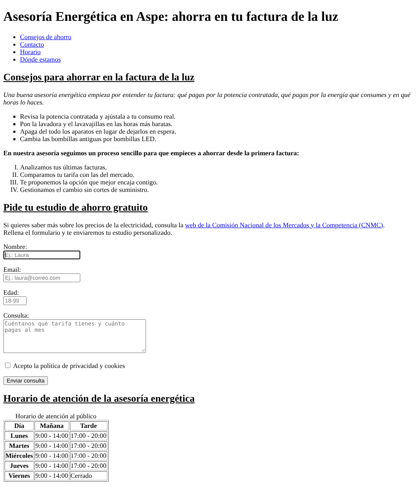

# Asesoría Energética en Aspe · Web en HTML5

Página web de una asesoría energética (ficticia) que ayuda a los clientes a entender y reducir su factura de la luz. Es la práctica de **HTML I y HTML II** del módulo *Lenguajes de Marcas y Sistemas de Gestión de Información* (2.º de DAW), ampliada después con optimización **SEO** y validación del código.

La temática viene de mi experiencia como asesor comercial en el sector de la energía.



## ✨ Funcionalidades
- **Cabecera** con título principal y menú de navegación interno.
- **Consejos de ahorro** con listas ordenadas y sin ordenar.
- **Formulario de contacto** validado solo con HTML5:
  - nombre (máx. 30 caracteres, solo letras y números, con expresión regular),
  - email, edad (entre 18 y 99) y consulta,
  - aceptación de la política de privacidad,
  - todos los campos obligatorios, con `label`, `placeholder` y foco inicial en el nombre.
- **Tabla de horario** con encabezados `<th>` y título `<caption>`.
- **Contenido incrustado**: imagen externa, mapa de Google Maps y vídeo de YouTube.
- **Aside** con accesos rápidos a cada sección mediante marcadores (`#id`).
- **Pie** con enlace para enviar un correo (`mailto:`) y para llamar (`tel:`).

## 🛠️ Tecnologías
- **HTML5** semántico: `header`, `nav`, `main`, `article`, `aside`, `footer`, `figure`.
- **SEO on-page**: `title` y `meta description` con palabras clave, un único `h1`, jerarquía `h2`/`h3`, `alt` descriptivo en las imágenes, metadatos `author`, `copyright` y `robots`.
- **Responsive**: metaetiqueta `viewport`.
- Sin CSS ni JavaScript (requisito de la práctica).
- Validado con **W3C Validator** / **HTMLHint**.

## ▶️ Cómo verla
1. Clona o descarga el repositorio:
   ```bash
   git clone https://github.com/josehub31/asesoria-energetica-html.git
   ```
2. Abre `index.html` en cualquier navegador.

## 📁 Estructura
```
├── index.html               # Página principal
├── UD3josebejerano.html     # Misma página, con el nombre pedido en la entrega
├── favicon.ico
└── img/
    └── captura.png
```

## 📝 Notas
- La lista con viñetas cuadradas usa `type="square"`, como pide el enunciado. Sin CSS no hay otra forma de hacerlo, y el validador lo marca como atributo obsoleto.
- Los datos de contacto son de ejemplo.

## 👤 Autor
**Jose Antonio Bejerano** · [github.com/josehub31](https://github.com/josehub31)
